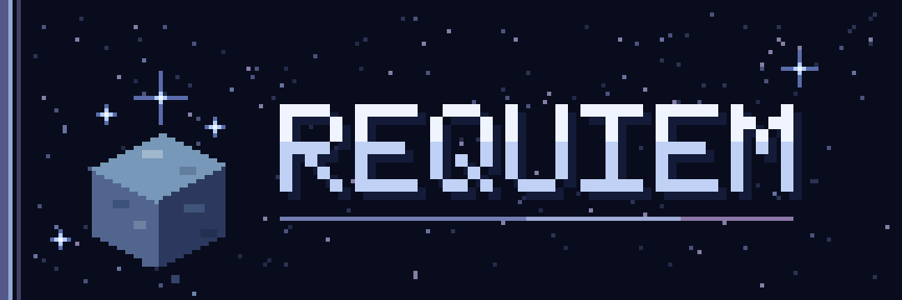

**Minecraft 1.21.1 · Fabric + NeoForge · Java 21**

[License](LICENSE) · [Issues](https://github.com/BareMinimumStudios/requiem/issues) · [Community](https://discord.gg/pcRw79hwey)

# Requiem

## The Between

A few stars come into focus. A question appears. *Where… am I?*

Requiem replaces the usual death screen with a quiet space called The Between. Click through a short dialogue, then choose whether to return to the world or decide later. When you return, faint glimpses of your last moments play newest first and recede as the stars stretch into lightspeed. The camera settles into first person as the soundtrack gives way to the sounds around you.

The glimpses come from your own play session. They’re low-resolution on purpose, held in memory, and never written to disk by Requiem.

## Decide what death costs

- **Unlimited** is the default. Return as often as you like, with the life counter hidden.
- **Limited** gives players a configurable number of lives.
- **Hardcore** makes the first qualifying death final.
- **Disabled** leaves the player on Minecraft's usual death flow.

Servers can decide which PvP, mob, and environmental deaths count, credit a recent attacker, and set exceptions by UUID or player name. Pending decisions survive disconnects and server restarts. Servers can also allow players to choose final death voluntarily. Final death asks for confirmation and can lead to Spectator, a dreamlike Limbo with an operator-controlled wake-up, or a dedicated-server ban.

## Make it fit your world

Change the dialogue, colors, particle density, timing, and sounds. Enable a first-join cinematic, turn off memories, or choose reduced motion, standard buttons, or muted cinematics. The death scene leaves the death reason out.

## Installation

Use the matching Requiem build on the client and server.

| Loader | Required dependencies |
| --- | --- |
| Fabric | Fabric API, Fabric Language Kotlin, Fzzy Config |
| NeoForge | Kotlin for Forge, Fzzy Config |

Incapacitated 2.0.1 is optional. Requiem waits for an actual death before opening The Between. A successful revive leaves the player's lives alone. Give-up and overkill were checked on dedicated Fabric and NeoForge servers.

### Tested setup

| Component | Fabric | NeoForge |
| --- | --- | --- |
| Loader | 0.20.1 | 21.1.267 |
| Fzzy Config | 0.7.7+1.21 | 0.7.7+1.21+neoforge |
| Kotlin runtime | Fabric Language Kotlin 1.13.7+kotlin.2.2.21 | Kotlin for Forge 5.11.0 |
| Fabric API | 0.116.15 | — |

## Configuration

Settings live in `config/requiem_cinematics/settings.toml`. Edit the file with the game or server stopped. Server rules control lives and final outcomes, and players can adjust the presentation on their own clients.

- Set `mortality` and `defaultLives` for the server default. Changing the starting allocation preserves existing life records.
- In `playerOverrides`, use a UUID or case-insensitive username with a value such as `LIMITED:3`, `HARDCORE`, `UNLIMITED`, or `DISABLED`. UUIDs take priority.
- Use `showLivesRemaining` to display the balance, `showLastMoments` to control memories, and `firstJoinCinematic` to enable the arrival sequence.
- Use `/requiem release <online player> <lives>` to release a player from Limbo and set their limited-mode allocation. On an integrated server, the ban policy falls back to Spectator.

## Build from source

Run `gradlew.bat build` on Windows or `./gradlew build` with Java 21. The loader JARs are written to `build/libs`. See the [development and verification notes](DEVELOPMENT.md) for test coverage and Incapacitated test setup.

Requiem uses the internal mod ID `requiem_cinematics`.

[The Bare Minimum License v1.0](LICENSE) applies to the project.
