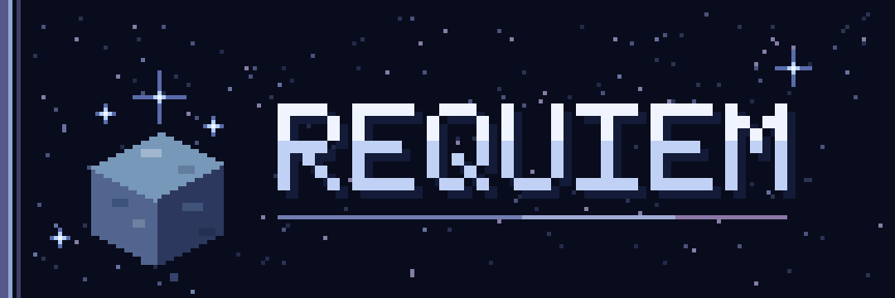
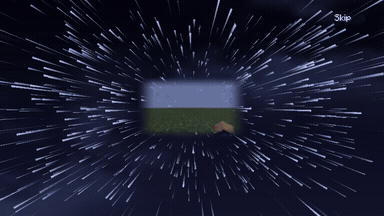
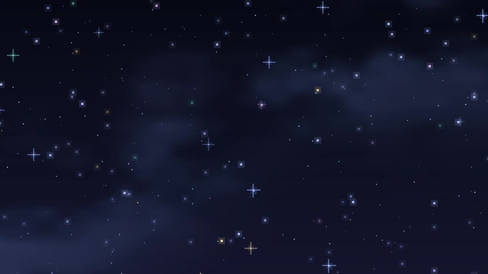
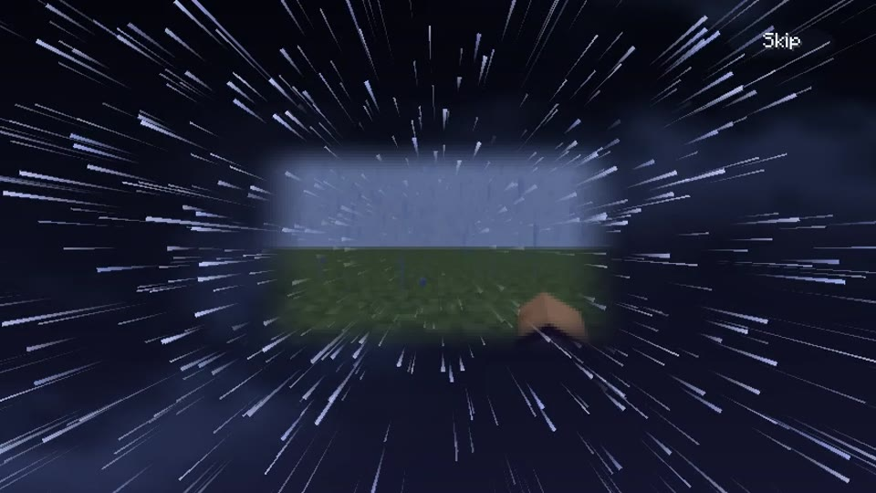
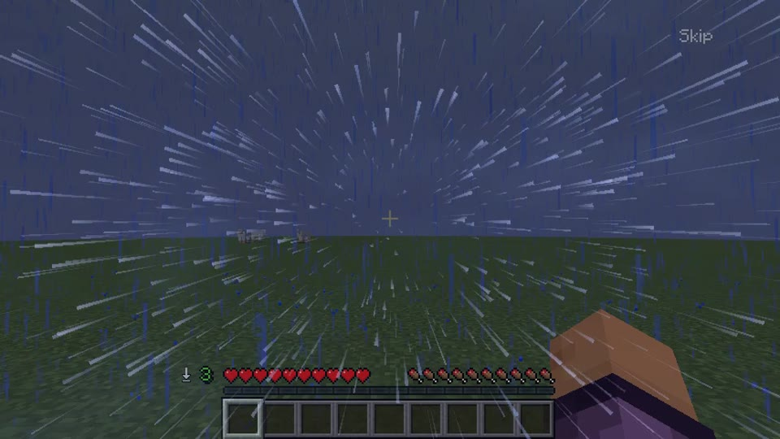

# Requiem Cinematics — CurseForge draft

**Summary** · A starlit death screen with fading memories, cinematic resurrection, and configurable lives.

**Project setup** · Minecraft Mods · Adventure and RPG · Client & Server · Custom license (The Bare Minimum License v1.1)

Use `requiem-cinematics` if available. Use the square logo for the project icon and the wide banner at the top of the description. They are title artwork. Use an in-game capture for the gallery.

---

<strong>Minecraft 1.21.1 · Fabric + NeoForge · Java 21</strong>

*Where… am I?*

Requiem replaces Minecraft’s death screen with **The Between**, a quiet place to decide whether to return. Choose to wake up and your last moments flicker past in reverse. The stars stretch into lightspeed, the camera eases back into first person, and the sounds of the world return.

## How it works

- **Return or decide later.** Lives are unlimited by default, and the counter is hidden. A pending choice survives reconnects and server restarts.
- **Set the stakes.** Choose Unlimited, Limited, Hardcore, or Disabled. Configure which PvP, mob, and environmental deaths count, with exceptions by player UUID or name.
- **Choose a final outcome.** Confirm final death to enter Spectator, wait in Limbo for an operator to release you, or trigger a dedicated-server ban, depending on the server’s settings.
- **Make The Between your own.** Adjust the dialogue, starfield, timing, and audio. Fading memories are optional and held in memory. Reduced motion, standard buttons, and muted cinematics are available.

## In game

**The Between**

**Lightspeed**

**Back in the world**

## Installation

Install the matching Requiem build on each client and on the server for multiplayer.

| Loader | Required dependencies |
| --- | --- |
| Fabric | Fabric API, Fabric Language Kotlin, Fzzy Config |
| NeoForge | Kotlin for Forge, Fzzy Config |

**Incapacitated 2.0.1** is optional. A successful revive does not spend a life. Give-up and overkill were tested on dedicated servers with both loaders.

## Links and support

[Configuration and documentation](https://github.com/BareMinimumStudios/requiem/blob/main/README.md) · [Report an issue](https://github.com/BareMinimumStudios/requiem/issues/new) · [Discord](https://discord.gg/pcRw79hwey) · [Ko-fi](https://ko-fi.com/pokesmells)

## Sponsor

Use code **`bareminimum`** to get **25% off your first month**!
